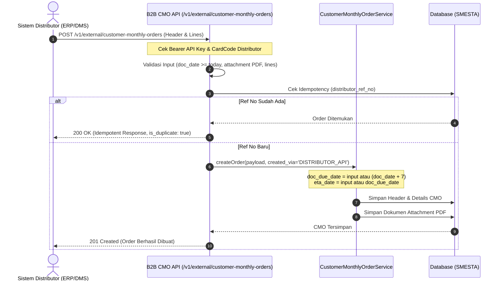

# 🔌 Panduan B2B API Customer Monthly Order (CMO External)

Dokumen ini menjelaskan spesifikasi teknis dan alur integrasi **B2B API Customer Monthly Order (CMO)** untuk sistem eksternal distributor (ERP/DMS) yang terintegrasi langsung dengan platform PT Susanti Megah.

---

## 1. Ringkasan & Aturan Bisnis

1. **Autentikasi:** Menggunakan API Key Bearer Token (`Bearer <API_KEY>`) yang terikat dengan distributor (`code_customer` / `card_code`).
2. **Idempotency Control:** Menggunakan field `distributor_ref_no` (Nomor PO Distributor). Jika distributor mengirim ulang request dengan `distributor_ref_no` yang sama, API akan merespon dengan status `200 OK` (`is_duplicate: true`) tanpa menduplikasi data di database.
3. **Aturan Tanggal (Date Rules):**
   - **`doc_date` (Posting Date):** Wajib diisi dengan format `YYYY-MM-DD`. **Tidak boleh backdate** (harus tanggal hari ini atau tanggal mendatang).
   - **`doc_due_date` (Delivery Date):** **Dapat diinput manual** oleh klien (format `YYYY-MM-DD`). Jika dikosongkan/tidak dikirim, backend secara otomatis mengisi nilai `doc_due_date` sebesar **H+7** dari `doc_date`.
   - **`eta_date` (Perkiraan Tiba):** **Dapat diinput manual** oleh klien (format `YYYY-MM-DD`). Jika dikosongkan/tidak dikirim, backend otomatis mengikuti `doc_due_date` atau **H+7** dari `doc_date`.
4. **Validasi Harga & Item:**
   - Klien dapat mengirimkan `unit_price: 0` atau harga manual; backend akan memvalidasi dan menyesuaikan dengan master harga distributor (`distributor_item_prices`).

---

## 2. Alur Proses (Sequence Diagram)



---

## 3. Spesifikasi Endpoint

### **`POST /api/distributor-channel/v1/external/customer-monthly-orders`**

#### A. Request Header
| Key | Tipe | Wajib | Keterangan |
| :--- | :--- | :--- | :--- |
| `Authorization` | String | **Ya** | `Bearer <API_KEY>` |
| `Content-Type` | String | **Ya** | `multipart/form-data` |
| `Accept` | String | **Ya** | `application/json` |

#### B. Request Body Fields
| Parameter | Tipe Data | Wajib | Format / Aturan | Keterangan |
| :--- | :--- | :--- | :--- | :--- |
| `card_code` | String | **Ya** | Max 50 karakter | Kode Distributor / Customer terdaftar yang berhak pada API Key ini |
| `distributor_ref_no` | String | **Ya** | Max 100 karakter | Nomor PO / Referensi Unik Distributor (**Idempotency Key**) |
| `doc_date` | Date | **Ya** | `YYYY-MM-DD` | Tanggal dokumen order / **Posting Date**. **Tidak boleh backdate** (minimal hari ini). |
| `doc_due_date` | Date | Tidak | `YYYY-MM-DD` | Tanggal jatuh tempo / **Delivery Date** yang diinginkan. *(Default: H+7 dari `doc_date` jika tidak diisi)*. |
| `eta_date` | Date | Tidak | `YYYY-MM-DD` | Tanggal perkiraan tiba (**ETA**). *(Default: mengikuti `doc_due_date` jika tidak diisi)*. |
| `po_number` | String | Tidak | Max 100 karakter | Nomor PO tambahan distributor |
| `comments` | String | Tidak | Text | Catatan umum order / instruksi khusus pengiriman |
| `attachment` | File (Binary) | **Ya** | PDF (.pdf), maks. 10 MB | Dokumen bukti PO fisik / lampiran pendukung |
| `lines` | Array / JSON String | **Ya** | Min. 1 item | Daftar item barang yang dipesan |

#### C. Detail Struktur `lines` (Item Array)
| Parameter Line | Tipe Data | Wajib | Keterangan |
| :--- | :--- | :--- | :--- |
| `item_code` | String | **Ya** | Kode SKU barang terdaftar di PT Susanti Megah |
| `quantity` | Numeric | **Ya** | Jumlah pesanan (harus > 0) |
| `unit_price` | Numeric | Tidak | Harga satuan (bisa dikirim `0` atau dikosongkan, backend mencocokkan ke master harga) |
| `unit_msr` | String | Tidak | Satuan barang (default: `CTN`) |

---

## 4. Contoh Request & Response

### Contoh Request (cURL)
```bash
curl -X POST "https://api-dev.susantimegah.com/api/distributor-channel/v1/external/customer-monthly-orders" \
  -H "Authorization: Bearer sm_live_xxxxxx" \
  -H "Accept: application/json" \
  -F "card_code=C110003074" \
  -F "distributor_ref_no=PO-DIST-202609-001" \
  -F "doc_date=2026-09-08" \
  -F "po_number=PO/SM/2026/09/01" \
  -F "comments=Pengiriman tahap 1 gudang utama" \
  -F "attachment=@/path/to/surat_po.pdf" \
  -F 'lines=[{"item_code":"B26","quantity":100,"unit_price":0}]'
```

### Contoh Response Berhasil (201 Created)
```json
{
  "success": true,
  "message": "Customer Monthly Order berhasil dibuat via External API.",
  "is_duplicate": false
}
```

### Contoh Response Validasi Gagal (422 Unprocessable Entity - Backdate)
```json
{
  "success": false,
  "message": "Validasi data CMO gagal.",
  "errors": {
    "doc_date": [
      "Tanggal dokumen (doc_date) tidak boleh backdate (harus tanggal hari ini atau tanggal mendatang)."
    ]
  }
}
```

### Contoh Response Idempotent (200 OK - Ref No Sudah Ada)
```json
{
  "success": true,
  "message": "Customer Monthly Order dengan distributor_ref_no ini sudah pernah dibuat sebelumnya (Idempotent Response).",
  "is_duplicate": true,
  "data": {
    "id": 128,
    "order_no": "CMO-202609-0001",
    "distributor_ref_no": "PO-DIST-202609-001",
    "doc_date": "2026-09-08",
    "doc_due_date": "2026-09-15",
    "eta_date": "2026-09-15",
    "status": "DRAFT"
  }
}
```
